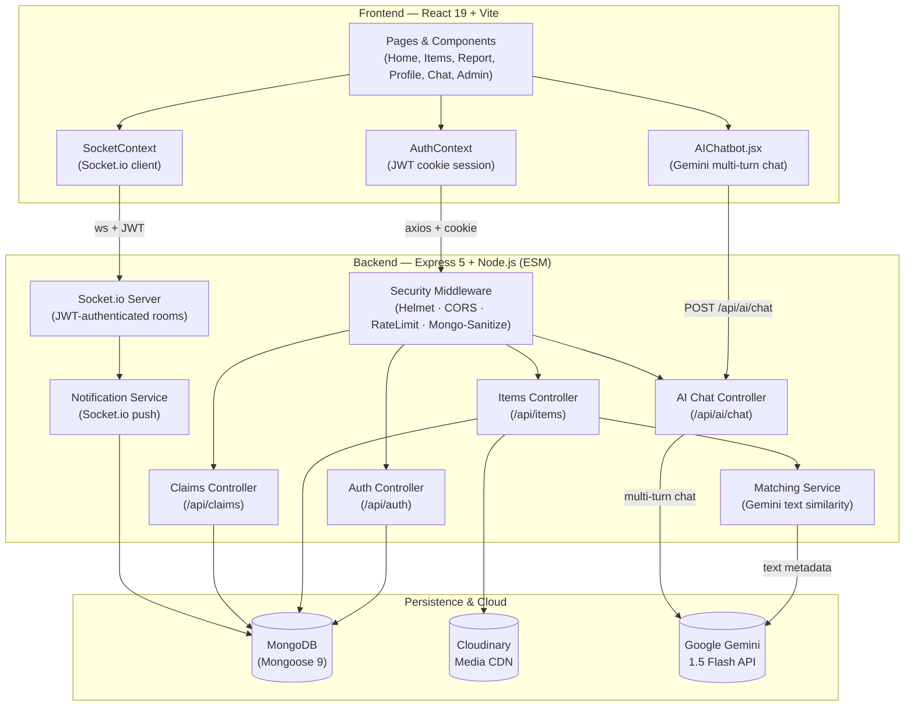
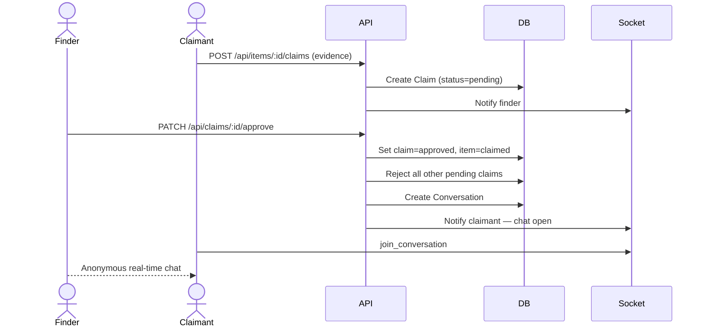

<div align="center">

  

  # Lost2Found
  ### AI-Powered Campus Lost &amp; Found Platform

  *A full-stack web application that connects students who lose items with those who find them — using Google Gemini AI for text-based similarity matching, real-time anonymous chat, and a fraud-resistant claims workflow.*

  <br />

  <p align="center">
    <a href="https://github.com/Shyaman014/Lost2Found/stargazers"></a>
    <a href="https://github.com/Shyaman014/Lost2Found/network/members"></a>
    <a href="https://github.com/Shyaman014/Lost2Found/issues"></a>
    
  </p>

  <p align="center">
    
    
    
    
    
    
    
    
    
  </p>

  <br />

  <p align="center">
    <a href="#-overview"><strong>Overview</strong></a> •
    <a href="#-key-features">Features</a> •
    <a href="#-system-architecture">Architecture</a> •
    <a href="#-tech-stack">Tech Stack</a> •
    <a href="#-getting-started">Setup</a> •
    <a href="#-api-reference">API Docs</a> •
    <a href="#-testing">Testing</a> •
    <a href="#-deployment">Deployment</a>
  </p>

</div>

---

## 📑 Table of Contents

- [Overview](#-overview)
- [Key Features](#-key-features)
- [System Architecture](#-system-architecture)
- [Tech Stack](#-tech-stack)
- [Project Structure](#-project-structure)
- [Getting Started](#-getting-started)
  - [Prerequisites](#prerequisites)
  - [Installation](#installation)
  - [Environment Variables](#environment-variables)
- [API Reference](#-api-reference)
- [Real-Time WebSockets](#-real-time-websockets)
- [Testing](#-testing)
- [Security & Privacy](#-security--privacy)
- [Screenshots](#-screenshots)
- [Deployment](#-deployment)
- [License](#-license)

---

## 💡 Overview

Managing lost property on campus is traditionally fragmented across informal WhatsApp groups, notice boards, and security desks. Items frequently remain unclaimed or are handed to unverified individuals.

**Lost2Found** replaces this friction with a structured, modern web application:

- **AI Text Similarity Matching** — Found items are automatically compared against lost reports using **Google Gemini 1.5 Flash**, scoring similarity across title, description, category, colour, brand, and location.
- **AI Chat Assistant** — A Gemini-powered conversational assistant helps users search the live item database, understand the claims workflow, and report items — with graceful fallback when the API is unavailable.
- **Privacy-Preserving Verification** — Real-time anonymous WebSocket chat lets finders and claimants communicate without sharing personal contact details.
- **Fraud-Resistant Claims Pipeline** — Claimants must submit identifying evidence (unique details they would only know if the item is theirs) before a claim can be approved.

> **Note on AI Matching:** Gemini analyses *textual metadata only* (title, description, category, colour, brand, location). Uploaded item images are stored but are not sent to the Gemini API as pixel data.

---

## 🌟 Key Features

| Category | Feature | Details |
| :--- | :--- | :--- |
| 🤖 **AI Matching** | **Text-Based Similarity** | Gemini 1.5 Flash compares lost ↔ found reports on textual metadata and returns a `0–100` confidence score |
| 💬 **AI Assistant** | **Gemini Chat** | Multi-turn conversational assistant grounded in live DB items; graceful fallback mode when API is unavailable |
| 🔴 **Real-Time** | **Anonymous Chat** | Socket.io WebSocket messaging opens a private channel between finder and approved claimant |
| 🛡️ **Verification** | **Evidence Claims** | Claimants submit distinctive details unknown to strangers; finders review and approve or reject |
| 🔍 **Discovery** | **Search & Filters** | Full-text search with category, status, type, date-range filters, sort, and pagination |
| 📊 **Admin** | **Dashboard & Analytics** | Moderation queue, user management, platform health metrics, recovery rates, and audit log |
| 📱 **UI/UX** | **Responsive Design** | React 19 + Tailwind CSS v4 with glassmorphism, micro-animations, and mobile-first navigation |
| 🔒 **Auth** | **Secure Sessions** | JWT in `HttpOnly` + `SameSite` cookies; role-based access control (Student / Admin) |
| 🧪 **Quality** | **Automated Tests** | 67 Vitest + Supertest integration tests covering auth, claims, items, and AI endpoints |
| 🖼️ **Media** | **Image Uploads** | Cloudinary integration with automatic local-filesystem fallback for development |

---

## 🏛️ System Architecture



### Data Flow: Claim Approval



---

## 🛠️ Tech Stack

### Frontend
| Library | Version | Role |
|---|---|---|
| [React](https://react.dev/) | 19 | UI framework |
| [Vite](https://vite.dev/) | 8 | Build tool & dev server |
| [Tailwind CSS](https://tailwindcss.com/) | v4 | Utility-first styling |
| [React Router DOM](https://reactrouter.com/) | 7 | Client-side routing |
| [Axios](https://axios-http.com/) | 1.x | HTTP client (cookie-aware) |
| [Socket.io Client](https://socket.io/) | 4.x | Real-time WebSocket client |

### Backend
| Library | Version | Role |
|---|---|---|
| [Node.js](https://nodejs.org/) | 22 (ESM) | Runtime |
| [Express](https://expressjs.com/) | 5 | Web framework |
| [Mongoose](https://mongoosejs.com/) | 9 | MongoDB ODM |
| [@google/generative-ai](https://ai.google.dev/) | 0.24 | Gemini AI (matching + chat) |
| [Socket.io](https://socket.io/) | 4 | WebSocket server |
| [Cloudinary](https://cloudinary.com/) | 2 | Image storage CDN |
| [Multer](https://github.com/expressjs/multer) | 2 | Multipart file handling |
| [jsonwebtoken](https://github.com/auth0/node-jsonwebtoken) | 9 | JWT generation & verification |
| [bcryptjs](https://github.com/dcodeIO/bcrypt.js) | 3 | Password hashing |
| [helmet](https://helmetjs.github.io/) | 8 | HTTP security headers |
| [express-rate-limit](https://github.com/express-rate-limit/express-rate-limit) | 8 | Per-IP & per-user rate limiting |
| [express-mongo-sanitize](https://github.com/fiznool/express-mongo-sanitize) | 2 | NoSQL injection prevention |

### Testing
| Library | Version | Role |
|---|---|---|
| [Vitest](https://vitest.dev/) | 5 | Test runner (native ESM) |
| [Supertest](https://github.com/ladjs/supertest) | 7 | HTTP assertion layer |
| [@vitest/coverage-v8](https://vitest.dev/) | 5 | Code coverage |

---

## 📂 Project Structure

```text
Lost2Found/
├── client/                        # Frontend (React 19 + Vite)
│   ├── public/                    # Static assets (logo, favicon)
│   └── src/
│       ├── components/            # Reusable UI components
│       │   ├── AIChatbot.jsx      # Gemini-powered floating chat widget
│       │   ├── ItemCard.jsx       # Item grid/list card
│       │   ├── ItemForm.jsx       # Lost/Found report form
│       │   ├── Navbar.jsx         # Responsive navigation
│       │   ├── admin/             # Admin moderation modals
│       │   ├── chat/              # Chat window & message bubbles
│       │   ├── claims/            # Claim review components
│       │   └── items/             # MatchCard, detail panels
│       ├── context/               # AuthContext · SocketContext
│       ├── layouts/               # Page layout wrappers
│       ├── pages/                 # Route-level views
│       │   ├── Home.jsx           # Landing page with hero & stats
│       │   ├── Items.jsx          # Browse/search all items
│       │   ├── ItemDetails.jsx    # Item detail + claims + matches
│       │   ├── Chat.jsx           # Anonymous conversation view
│       │   ├── Profile.jsx        # User profile & settings
│       │   └── admin/             # Admin dashboard pages
│       └── services/              # Axios API clients
│
├── server/                        # Backend (Express 5 + Socket.io)
│   ├── config/                    # DB, Socket.io, Cloudinary config
│   ├── controllers/               # Business logic per domain
│   │   ├── authController.js      # Register, login, profile
│   │   ├── itemController.js      # CRUD + status management
│   │   ├── claimController.js     # Claims lifecycle
│   │   ├── matchController.js     # AI similarity trigger
│   │   ├── aiController.js        # Gemini chat endpoint
│   │   ├── conversationController.js # Messages & chat history
│   │   ├── adminController.js     # User/item/report moderation
│   │   └── adminAnalyticsController.js # Platform metrics
│   ├── middleware/                # Auth guards · rate limiters · error handler
│   ├── models/                    # Mongoose schemas
│   │   ├── User.js               # Roles: student | admin
│   │   ├── Item.js               # Lost/Found reports
│   │   ├── Claim.js              # Evidence-based claims
│   │   ├── Match.js              # AI similarity results
│   │   ├── Conversation.js       # Anonymous chat threads
│   │   ├── Message.js            # Chat messages
│   │   ├── Notification.js       # In-app push events
│   │   ├── Report.js             # Flagged content
│   │   └── AuditLog.js           # Admin action history
│   ├── routes/                    # RESTful route definitions
│   ├── services/                  # Domain services
│   │   ├── ai/chatService.js     # Gemini multi-turn chat logic
│   │   ├── ai/aiProvider.js      # Gemini item-matching engine
│   │   ├── matchingService.js    # Match orchestration pipeline
│   │   ├── analyticsService.js   # Metrics aggregation
│   │   ├── notificationService.js # Socket.io push dispatcher
│   │   └── cloudinaryService.js  # Image upload/delete
│   ├── tests/                     # Vitest integration test suites
│   │   ├── auth.test.js          # 22 auth tests
│   │   ├── claims.test.js        # 16 claims tests
│   │   ├── items.test.js         # 17 items tests
│   │   └── ai.test.js            # 12 AI chat tests
│   ├── app.js                     # Express app setup (no DB)
│   ├── server.js                  # HTTP + WebSocket entry point
│   └── vitest.config.js           # Test runner configuration
│
└── package.json                   # Root workspace (concurrently)
```

---

## 🚀 Getting Started

### Prerequisites

- **Node.js** v18+ (tested on v22)
- **MongoDB** — Local instance or [MongoDB Atlas](https://www.mongodb.com/atlas) (free tier)
- **Google Gemini API Key** — Free from [Google AI Studio](https://aistudio.google.com/app/apikey)
- *(Optional)* **Cloudinary** account for image CDN — the app falls back to local storage without it

---

### Installation

```bash
# 1. Clone the repository
git clone https://github.com/Shyaman014/Lost2Found.git
cd Lost2Found

# 2. Install all dependencies (root + server + client)
npm run install-all

# 3. Configure environment variables (see below)
cp server/.env.example server/.env
# Edit server/.env with your values

# 4. Start the development servers concurrently
npm run dev
```

| Service | URL |
|---|---|
| Frontend | `http://localhost:5173` |
| Backend | `http://localhost:5000` |
| API Health | `http://localhost:5000/api/health` |

> **Demo Login** — `POST /api/auth/demo` creates a guest session with no sign-up required. Useful for quick evaluation.

---

### Environment Variables

#### `server/.env`

```env
# ── Server ─────────────────────────────────────────
PORT=5000
NODE_ENV=development
CLIENT_URL=http://localhost:5173

# ── Database ───────────────────────────────────────
MONGO_URI=mongodb://localhost:27017/lost2found

# ── Authentication ─────────────────────────────────
JWT_SECRET=your_strong_random_secret_here
JWT_EXPIRES_IN=30d

# ── Google Gemini AI ───────────────────────────────
# Get a free key at https://aistudio.google.com/app/apikey
GEMINI_API_KEY=your_gemini_api_key_here
GEMINI_MODEL=gemini-1.5-flash        # Item-matching model
GEMINI_CHAT_MODEL=gemini-1.5-flash   # AI chat assistant model
AI_MATCH_THRESHOLD=70                # Min score (0–100) to surface a match

# ── Cloudinary (optional) ──────────────────────────
# If omitted, images are stored in server/public/uploads/
CLOUDINARY_CLOUD_NAME=your_cloud_name
CLOUDINARY_API_KEY=your_api_key
CLOUDINARY_API_SECRET=your_api_secret
```

#### `client/.env`

```env
VITE_API_BASE_URL=http://localhost:5000/api
```

> ⚠️ **Never commit real credentials.** The repository includes `server/.env.example` with safe placeholder values and `server/.env.test` for the test suite. Both are safe to commit.

---

## 📡 API Reference

All endpoints are prefixed with `/api`. Authenticated routes require the `jwt` HttpOnly cookie set by `/api/auth/login` or `/api/auth/register`.

### Authentication (`/api/auth`)

| Method | Endpoint | Description | Access |
| :--- | :--- | :--- | :--- |
| `POST` | `/register` | Create a student account | Public |
| `POST` | `/login` | Authenticate and set JWT cookie | Public |
| `POST` | `/demo` | One-click demo session (no sign-up) | Public |
| `POST` | `/logout` | Clear JWT cookie | Public |
| `GET` | `/me` | Get current authenticated user | Private |
| `PUT` | `/profile` | Update profile name/photo (FormData) | Private |

### Items (`/api/items`)

| Method | Endpoint | Description | Access |
| :--- | :--- | :--- | :--- |
| `GET` | `/` | List items with search, filters, sort & pagination | Public |
| `POST` | `/` | Report a lost or found item (image optional) | Private |
| `GET` | `/my` | Get items reported by the current user | Private |
| `GET` | `/:id` | Get full item details | Public |
| `PUT` | `/:id` | Update item report (image optional) | Private (Owner) |
| `DELETE` | `/:id` | Delete item report | Private (Owner/Admin) |
| `DELETE` | `/:id/image` | Remove item image | Private (Owner) |
| `PATCH` | `/:id/status` | Toggle item status (`active` / `resolved`) | Private (Owner) |
| `PATCH` | `/:id/returned` | Mark item as physically returned | Private (Owner) |
| `POST` | `/:id/match` | Trigger on-demand Gemini AI similarity scan | Private |
| `GET` | `/:id/matches` | Get AI match results for an item | Private |
| `POST` | `/:id/claims` | File an ownership claim with evidence | Private |
| `GET` | `/:id/claims` | View incoming claims (finder only) | Private |

### Claims (`/api/claims`)

| Method | Endpoint | Description | Access |
| :--- | :--- | :--- | :--- |
| `GET` | `/my` | Claims filed by current user | Private |
| `PATCH` | `/:id/approve` | Approve a claim & open conversation | Private (Finder) |
| `PATCH` | `/:id/reject` | Reject a claim with reason | Private (Finder) |
| `PATCH` | `/:id/cancel` | Cancel a pending claim | Private (Claimant) |

### Conversations (`/api/conversations`)

| Method | Endpoint | Description | Access |
| :--- | :--- | :--- | :--- |
| `GET` | `/` | List active conversation threads | Private |
| `GET` | `/:id` | Get conversation details | Private (Participant) |
| `GET` | `/:id/messages` | Get full message history | Private (Participant) |
| `PATCH` | `/:id/read` | Mark messages as read | Private (Participant) |

### AI Assistant (`/api/ai`)

| Method | Endpoint | Description | Access |
| :--- | :--- | :--- | :--- |
| `POST` | `/chat` | Multi-turn Gemini chat (with live DB context) | Private |

**Request body:**
```json
{
  "message": "Did anyone find a black Casio calculator near the library?",
  "history": [
    { "role": "user", "text": "I lost my calculator." },
    { "role": "ai",   "text": "What does it look like?" }
  ]
}
```

**Response:**
```json
{
  "success": true,
  "data": {
    "reply": "Yes! A **black Casio calculator** was reported found at **the Library** on 10 Oct.",
    "fallback": false
  }
}
```

### Admin (`/api/admin`) — Admin role required

| Method | Endpoint | Description |
| :--- | :--- | :--- |
| `GET` | `/dashboard/stats` | Platform summary metrics |
| `GET` | `/analytics/overview` | Detailed recovery & activity analytics |
| `GET` | `/users` | List all users with filters |
| `PATCH` | `/users/:id/status` | Activate or ban a user |
| `PATCH` | `/users/:id/role` | Change user role |
| `GET` | `/items` | All items with moderation status |
| `PATCH` | `/items/:id/moderate` | Flag or remove an item |
| `GET` | `/claims` | All claims platform-wide |
| `GET` | `/reports` | Flagged content reports |
| `PATCH` | `/reports/:id` | Review and resolve a report |
| `GET` | `/activity` | Admin audit log |

---

## ⚡ Real-Time WebSockets

Socket.io connections require a valid JWT cookie — unauthenticated or inactive-user connections are rejected at the handshake level.

| Event | Direction | Payload | Description |
| :--- | :--- | :--- | :--- |
| `join_conversation` | Client → Server | `{ conversationId }` | Join a private conversation room |
| `send_message` | Client → Server | `{ conversationId, text }` | Send a message |
| `receive_message` | Server → Client | `{ message, conversationId }` | Deliver new message to room members |
| `typing` | Client → Server | `{ conversationId, isTyping }` | Live typing indicator |
| `message_read` | Server → Client | `{ conversationId }` | Read receipt broadcast |

---

## 🧪 Testing

The test suite uses **Vitest 5** (native ESM) + **Supertest 7** against a dedicated `l2f_test` MongoDB database. No real Gemini or Cloudinary calls are made during tests — both services use placeholder credentials and fall back gracefully.

```bash
# Run all tests (one-shot, CI-friendly)
npm test

# Watch mode for development
npm run test:watch

# With v8 code coverage report
npm run test:coverage
```

**Results — 67/67 Passing**

| Test File | Tests | Coverage |
|---|---|---|
| `tests/auth.test.js` | 22 | Registration · Login · `/me` · Logout · RBAC |
| `tests/claims.test.js` | 16 | Full lifecycle · Duplicate · Self-claim · Approve · Reject · Cancel |
| `tests/items.test.js` | 17 | Public access · CRUD · Ownership · Privilege escalation · `identifyingDetails` |
| `tests/ai.test.js` | 12 | Auth guard · Input validation · Fallback mode · History handling |

---

## 🔒 Security & Privacy

| Protection | Implementation |
|---|---|
| **XSS-safe token storage** | JWT stored in `HttpOnly` + `SameSite` cookies — inaccessible to JavaScript |
| **NoSQL injection** | `express-mongo-sanitize` filters `$` operators from request body and params |
| **Rate limiting** | Global 1000 req/15 min; Auth 10 req/15 min (prod); AI chat 20 msg/10 min per user |
| **HTTP header hardening** | `helmet` with `Cross-Origin-Resource-Policy: cross-origin` |
| **Password hashing** | `bcryptjs` with salt factor 10 |
| **Role-based access** | `authorizeRoles()` middleware enforces `student` / `admin` separation |
| **Socket.io auth** | JWT verified on every WebSocket handshake; inactive users are disconnected |
| **Field stripping** | `moderationStatus` and `status` fields are stripped from PUT request bodies |
| **`identifyingDetails` guard** | Hidden from non-owners and public listings; only shown to the item reporter |

---

## 📸 Screenshots

> *Screenshots can be added here once the app is deployed. The sections below show the key screens.*

| Screen | Description |
|---|---|
| **Home** | Hero section with platform stats and recent items |
| **Items Browse** | Searchable grid with category/status filters |
| **Item Detail** | Full report with AI match suggestions and claim form |
| **Anonymous Chat** | Real-time conversation between finder and claimant |
| **AI Assistant** | Floating Gemini chat widget with markdown bold rendering |
| **Admin Dashboard** | Platform health, user management, moderation queue |

---

## 🌐 Deployment

### Frontend — Vercel / Netlify

1. Set **Root Directory** to `client`
2. **Build Command:** `npm run build`
3. **Output Directory:** `dist`
4. Add environment variable:
   ```
   VITE_API_BASE_URL=https://your-backend.com/api
   ```

### Backend — Render / Railway / VPS

1. Set **Root Directory** to `server`
2. **Build Command:** `npm install`
3. **Start Command:** `node server.js`
4. Set environment variables:
   ```
   NODE_ENV=production
   CLIENT_URL=https://your-frontend.com
   MONGO_URI=<Atlas connection string>
   JWT_SECRET=<strong random secret>
   GEMINI_API_KEY=<your key>
   GEMINI_MODEL=gemini-1.5-flash
   GEMINI_CHAT_MODEL=gemini-1.5-flash
   AI_MATCH_THRESHOLD=70
   CLOUDINARY_CLOUD_NAME=<name>
   CLOUDINARY_API_KEY=<key>
   CLOUDINARY_API_SECRET=<secret>
   ```

> In production, set `NODE_ENV=production` to enable `SameSite=strict` cookies, disable rate limit relaxation, and suppress error stack traces in API responses.

---

## 🤝 Contributing

Contributions are welcome!

1. Fork the project
2. Create a feature branch: `git checkout -b feature/my-feature`
3. Commit using conventional commits: `git commit -m 'feat: add my feature'`
4. Push and open a Pull Request

---

## 📄 License

This project is licensed under the **MIT License**.

---

<div align="center">
  <sub>Designed & Developed with ❤️ by <a href="https://github.com/Shyaman014">Shyaman014</a></sub>
</div>
